# 08. Ontology

[목차](../README.md) \| 이전: [07. 정답 계산과 Genie](07-genie.md) \| 다음: [09. Data agent로 Ontology에 질문하기](09-data-agent.md)

06장에서 계산한 재고와 대응안을 이제 **업무 용어와 관계로 연결**합니다. 목표는 **업무 목적과 질문을 전달하면 Ontology agent가 원본 데이터를 조사해 엔터티·키·관계를 제안하는 과정**을 경험하고, 그 설계가 실제 데이터를 읽고 업무 질문을 지원하는지 검토하는 것입니다. 이 Ontology를 바탕으로 09장에서 "어느 Bunker가 부족한가?", "어떤 대응안을 추천하는가?"를 질문합니다.

**빈 Ontology 만들기 → 에이전트 초안 검토 → Act로 적용 → 키·바인딩·데이터 점검** 순서로 진행합니다. **1–4단계가 필수**이며, 5단계의 Graph 생성은 선택입니다.

## 시작 전 확인

- 05·06장을 마치고 **본인 작업 영역·Lakehouse의 Tables → gold**에 테이블 21개가 있는지 확인합니다. 에이전트가 업무 질문에 필요한 테이블을 골라 설계합니다. 테이블 수와 엔터티 타입 수가 반드시 같아야 하는 것은 아닙니다.
- 특히 06장에서 저장하는 `fact_response_option`(4행), `fact_option_balance`(460행), `fact_risk_event`(1행)를 본인 Lakehouse에서 각각 열어 확인합니다. 05장만 실행하면 이 세 테이블은 없습니다. 테이블이 보여도 읽기에 실패하면 원본 확인이 끝난 것이 아닙니다.
- 참가자에게 작업 영역 **Contributor** 이상 권한과 원본 테이블 읽기 권한이 있어야 합니다. 관리자가 **Users can create Fabric items**, **Users can create ontology (preview) items**, Azure OpenAI 기반 Copilot·AI 기능 설정을 참가자에게 허용했는지 확인합니다.
- 전체 실습에 준비된 **활성 유료 Fabric 용량**을 사용합니다. 지역·테넌트 설정은 [관리자 준비 가이드](../admin/README.md)의 "3. Microsoft Fabric"을 따릅니다([Ontology 테넌트 설정](https://learn.microsoft.com/en-us/fabric/iq/ontology/overview-tenant-settings), [Copilot 지역·용량 조건](https://learn.microsoft.com/en-us/fabric/fundamentals/copilot-fabric-overview#available-regions), [Ontology MCP 조건](https://learn.microsoft.com/en-us/fabric/iq/ontology/how-to-use-ontology-mcp-server#prerequisites)).

문서·캡처의 `p001`은 예시입니다. 작업 영역 `chipbalance-p001`과 Lakehouse `lh_chipbalance_p001`은 **본인 번호의 이름**을 사용합니다. Ontology 이름은 `ont_chipbalance`로 유지합니다.

캡처는 **17개 엔터티·26개 관계로 만든 참고 설계**입니다. 이번 실습은 이 개수나 이름을 정답으로 강제하지 않습니다. AI의 설계·문장·도구 호출·처리 시간은 달라질 수 있습니다. **완료 문구나 개수보다 업무 범위·실제 키·관계·바인딩을 기준으로 확인**합니다.

## 1. Ontology 만들기

1.  <https://app.fabric.microsoft.com>에서 **Workspaces / 작업 영역**을 열고, 본인 작업 영역 `chipbalance-p001`에서 **+ New item**을 누릅니다.

2.  **New item** 창의 검색 칸에 `Ontology`를 입력하고 **Ontology (preview)**를 누릅니다.

    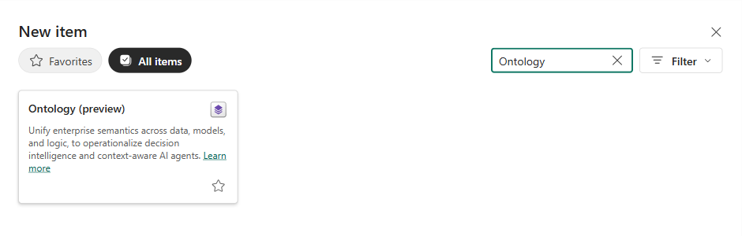

3.  **New Ontology** 창에서 **Name**에 `ont_chipbalance`를 입력하고, **Location**이 `chipbalance-p001`인지 확인한 뒤 **Create**를 누릅니다.

    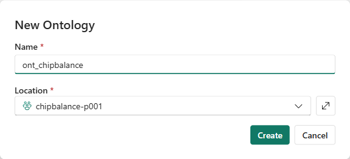

4.  **Welcome to Ontology** 창이 나오면 오른쪽 위 **X**를 눌러 닫습니다.

**예상 결과:** 가운데에 **Get started**와 카드 3개(**Start with Ontology agent**, **Import ontology**, **Learn more**)가 보입니다. 왼쪽 **Explorer**에는 아직 엔터티 타입이 없습니다.

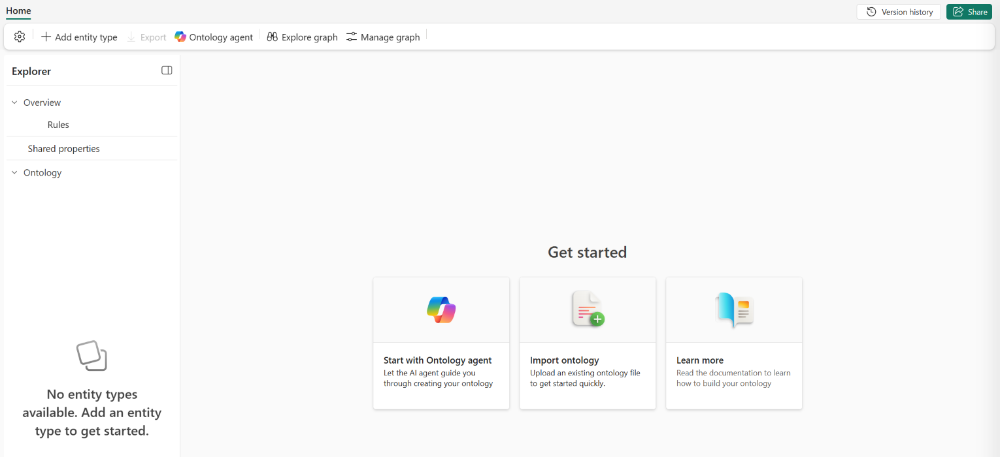

## 2. Ontology agent로 초안 만들기

Ontology는 업무 개념인 **엔터티 타입**, 개념 사이의 **관계**, 원본 테이블을 연결하는 **데이터 바인딩**으로 구성됩니다. 예를 들어 `Bunker`는 엔터티 타입 하나이고, `gold.dim_bunker`의 각 행은 실제 Bunker 하나인 **인스턴스**입니다. 타입 수와 데이터 행 수를 구분합니다.

아래 표는 **에이전트의 제안을 검토할 때 비교하는 참고 설계**입니다. 표를 프롬프트에 붙여 넣어 구조를 지정하지 않습니다. 에이전트가 엔터티·속성·키·관계를 제안하고, 참가자는 어떤 원본과 업무 근거로 제안했는지 확인합니다.

| 엔터티 타입 | 테이블 (키) | 한 행의 의미 |
|----|----|----|
| Line, Bunker, Material, Supplier, Product, Customer | `gold.dim_*` | 라인, 원료 Bunker, 원료, 공급사, 제품, 고객 기준 정보 |
| TransferRoute | `gold.dim_route` (`route_id`) | Bunker 간 이송 경로. 보내는 Bunker와 받는 Bunker |
| Scenario | `gold.dim_scenario` (`scenario_id`) | `baseline`(현재 계획), `emergency`(긴급 수주 반영) |
| SalesOrder, OrderFulfillment | `gold.fact_sales_order`, `gold.fact_order_fulfillment` | 판매오더, 시나리오별 납기 준수 여부 |
| ProductionPlan | `gold.fact_plan` (`plan_key`) | 시나리오별 생산계획 한 건 |
| DailyBalance | `gold.fact_balance` (`balance_key`) | 시나리오·Bunker·날짜별 원료 재고 |
| BunkerRisk | `gold.fact_bunker_summary` (`summary_key`) | 시나리오·Bunker별 미달 일수, 최저 재고, 필요 보충량 |
| InboundDelivery | `gold.fact_inbound` (`inbound_key`) | 입고 예정 한 건 |
| ResponseOption, OptionBalance | `gold.fact_response_option`, `gold.fact_option_balance` | 긴급 수주 대응안 4개와 대응안별 Bunker 재고 |
| RiskEvent | `gold.fact_risk_event` (`event_id`) | 06장에서 감지한 부족 이벤트와 추천 대응안 |

1.  **Start with Ontology agent** 카드를 누릅니다. 오른쪽에 **Ontology Agent** 창이 열립니다.

    이 단계는 Ontology 항목 안의 **내장 Ontology agent로 구조를 작성**합니다. 업무 질문용 별도 Data agent는 **09장에서** 만듭니다. 입력 칸 아래 스위치가 **Plan**인지 확인하고, 다른 모드이면 **Plan**을 누릅니다. Plan은 초안·검증 단계이고 **Act**가 변경을 적용하는 단계입니다.

2.  **Say something** 칸에 아래 프롬프트를 붙여 넣습니다. 참가자 번호가 `p001`이 아니면 첫 줄의 `lh_chipbalance_p001`을 본인 Lakehouse로 바꿉니다.

    ``` text
    lh_chipbalance_p001 Lakehouse의 gold 스키마를 조사해서 필름 공장의 원료 Chip Balance 온톨로지를 설계해줘.
    목적은 현재 생산계획과 긴급 수주를 반영한 계획을 비교하고, 원료 부족·납기·대응안의 판단 근거를 담당자가 따라갈 수 있게 하는 거야.
    아래 업무 질문에 필요한 엔터티, 속성, 고유 키, 관계와 데이터 바인딩을 제안하고 선택 이유를 설명해줘. 개수와 구조는 원본을 보고 판단해줘.
    - 현재 계획에서 안전재고를 밑도는 원료 벙커가 있는가?
    - 긴급 수주를 반영하면 어느 벙커가 언제부터 부족하고, 얼마나 보충해야 하는가?
    - 생산을 뒤로 미룬 판매오더의 납기를 지킬 수 있는가?
    - 벙커 간 이송 시 보내는 쪽과 받는 쪽의 재고가 전체 기간 동안 안전한가?
    - 다음 입고 예정은 언제이며, 어느 공급사에서 얼마나 들어오는가?
    - 대응안을 안전재고·용량·납기·이송 한도·추가 비용으로 비교하면 어떤 안을 추천할 수 있는가? 위험 이벤트에서 원인 오더와 추천안까지 연결해서 볼 수 있는가?
    gold만 사용하고 dbo와 Files는 쓰지 마. 이름은 영어, 설명과 동의어는 한국어로 작성하고 Bunker는 '벙커'로 설명해줘.
    원본 열과 실제 행으로 키·관계를 검증해줘. 필요한 데이터 읽기에 실패하면 테이블이 없다고 단정하지 말고, 조회 대상과 오류 원문, 해결하지 못한 업무 질문을 보고하고 중단해. 데이터나 연결을 추측해서 만들지 마.
    먼저 Plan에서 설계 근거, 검증 결과와 미리 보기를 보여줘. 적용은 내가 검토하고 Act에서 승인한 다음에 해.
    ```

    **설계 검토:** 에이전트가 어떤 업무 질문을 어떤 엔터티·관계로 지원하는지 설명하는지 확인합니다. 관계 방향은 하나로 고정하지 않습니다. [공식 예시](https://learn.microsoft.com/en-us/fabric/iq/ontology/how-to-create-relationship-types)는 `DriverId`가 Truck 테이블에 있어도 Driver → Truck으로 정의하고 매핑 테이블을 연결합니다. 양쪽 속성·키·원본 데이터 매핑이 맞는지가 중요합니다.

3.  오른쪽 아래 화살표를 눌러 보냅니다. 에이전트가 Lakehouse의 열과 샘플 행을 살펴보고 초안을 만든 뒤 검증합니다. 참고 시간은 3–5분입니다.

**확인할 결과:** 제안된 엔터티·키·관계·원본 테이블과 **업무 질문별 설계 근거**, 검증 결과가 있습니다. 위 질문 모두에 필요한 데이터와 연결이 포함되어야 합니다. 참고 설계는 17개 엔터티·26개 관계이며, 계산 지원 테이블 4개를 제외하지만 같은 개수로 맞출 필요는 없습니다. **업무 범위 누락이나 미해결 조회 오류가 있으면 적용하지 않고** 같은 Plan 대화에서 보완을 요청합니다. 아직 초안이므로 Ontology에 저장된 것은 아닙니다.

**아래 캡처는 참고 설계의 결과입니다.** 개수가 다르다는 이유만으로 실패 또는 성공으로 판단하지 않습니다.

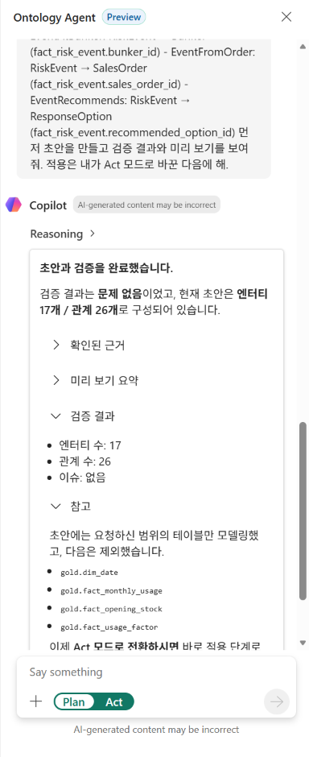

## 3. 미리 보기와 적용

1.  답 아래 **Preview ontology**를 누릅니다. 가운데 캔버스에 초안이 열립니다.

2.  캔버스 왼쪽 아래 **Fit to screen** 아이콘(네 모서리 모양)을 눌러 전체를 봅니다.

    **확인할 결과:** 위에 "You are viewing a proposed ontology from the agent. Approve to keep this ontology. This is a read-only view."가 보이고, 왼쪽 **Explorer**의 **AI Proposal**에 제안된 엔터티가 있습니다. 캔버스의 타입·관계가 검토한 초안과 일치하고 업무 질문을 지원하는지 확인합니다. 아래 참고 화면은 `Visible: 17 of 17 entities | 26 of 26 relationships`이지만 본인의 개수는 달라도 됩니다. 이 캔버스는 **타입과 관계의 설계도**이며 인스턴스 Graph가 아닙니다.

    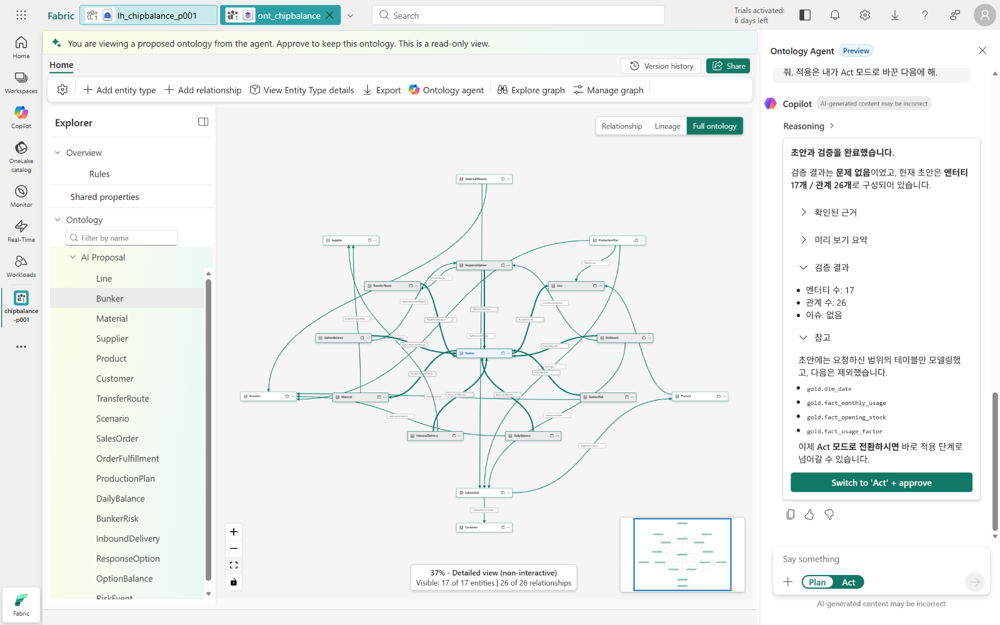

3.  업무 범위·원본 매핑·검증 결과에 미해결 문제가 없으면 에이전트 창의 **Switch to 'Act' + approve**를 누릅니다. 스위치가 **Act**로 바뀌고 에이전트가 초안을 적용합니다. 참고 시간은 2–3분입니다.

    **버튼이 없는 UI:** Plan 답에 텍스트 초안만 있고 **Preview ontology**·**Switch to 'Act' + approve**가 없으면, 답의 엔터티·관계 목록과 검증 결과를 먼저 검토합니다. 캔버스 미리 보기가 열린 것으로 간주하지 않습니다. 문제가 없을 때 직접 **Act**를 선택하고 `업무 질문과 원본 매핑을 검토한 초안을 적용해줘. gold 스키마만 사용하고 내가 검토한 엔터티·키·관계·바인딩을 유지해줘.`를 보냅니다. 적용 뒤 아래 Explorer와 4단계의 키·바인딩을 확인합니다.

**확인할 결과:** 답에 적용 완료가 표시되고, 왼쪽 **Explorer**의 **Entity Types**에 검토한 초안의 엔터티가 있습니다. **AI Proposal이 아니라 Entity Types에 나타나는지** 확인한 뒤, 다음 단계에서 저장된 키와 원본 연결을 점검합니다. 아래 캡처의 이름·개수는 참고 설계입니다.

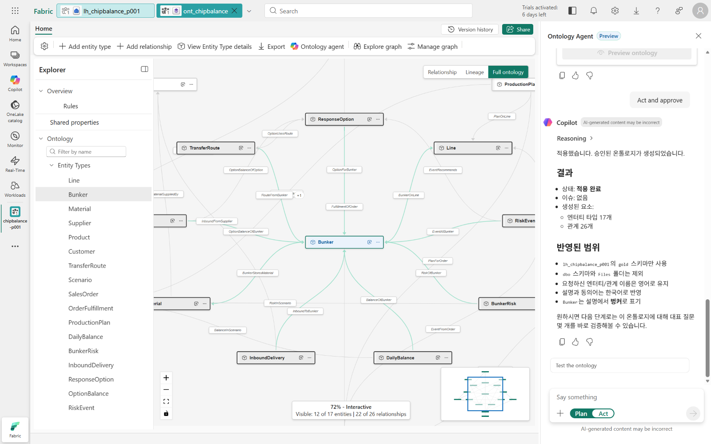

## 4. 엔터티 타입과 관계 점검

생성 완료는 점검의 시작입니다. **Configure는 설계·원본 연결, Instances는 실제 데이터**를 확인하는 곳입니다. 아래는 참고 설계의 Bunker와 일별 재고 관계를 점검하는 예시입니다. 본인 설계에서 이름이 다르면 같은 업무 개념과 원본에 연결된 타입·관계를 찾아 점검합니다. 한국어 설명·동의어는 09장의 질문 해석에 쓰입니다.

1.  오른쪽 위 **X**를 눌러 에이전트 창을 닫습니다.

2.  왼쪽 **Explorer**에서 **Bunker**(또는 `gold.dim_bunker`에 연결된 타입)를 누르고, 리본의 **View Entity Type details**를 누릅니다. 안내 풍선이 나오면 **X**로 닫습니다.

    **확인할 결과:** **Configure** 탭의 키가 원본에서 행을 유일하게 식별하고, 업무 질문에 필요한 속성의 **Data source**가 올바른 원본 열에 연결됩니다. 참고 설계는 키 `bunker_id`와 속성 6개(`bunker_id`, `bunker_name`, `capacity_kg`, `line_id`, `material_id`, `safety_stock_kg`)를 씁니다. **Entity metadata**의 한국어 **Description**·**Synonyms**와 오른쪽 **Relationships**의 연결도 확인합니다.

    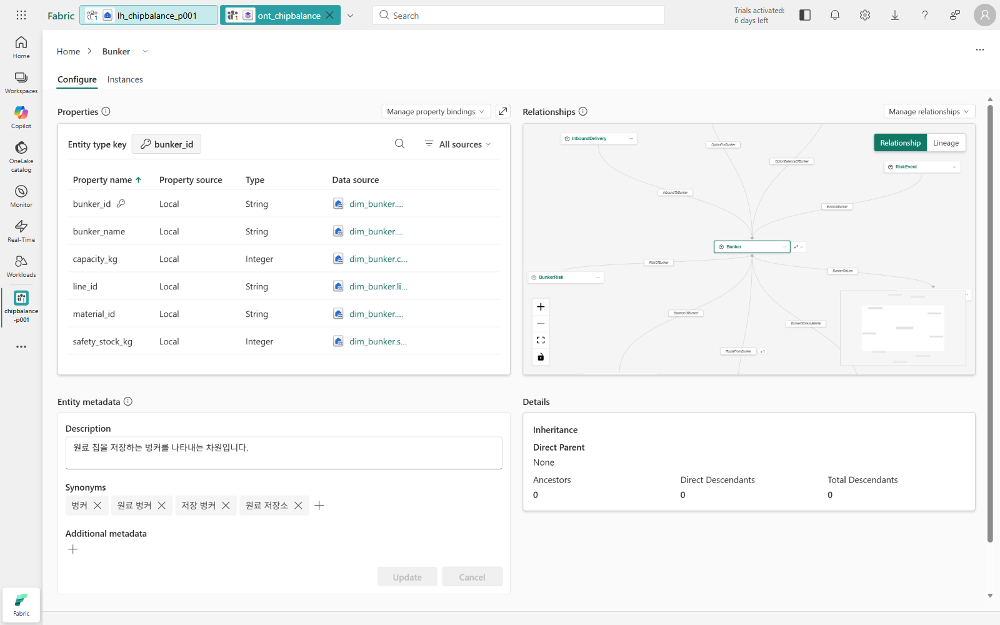

3.  **Instances** 탭을 누릅니다. 안내 풍선이 나오면 **X**로 닫습니다.

    **확인할 결과:** `gold.dim_bunker`의 Bunker **24개**가 읽힙니다. 표에서 `BNK-L3-2`를 찾아 이름 `L3 PET-SD`, 용량 `150000`, 안전재고 `12000`을 확인합니다. 이는 에이전트가 만든 예시 값이 아니라 **바인딩한 원본 테이블의 데이터**입니다.

    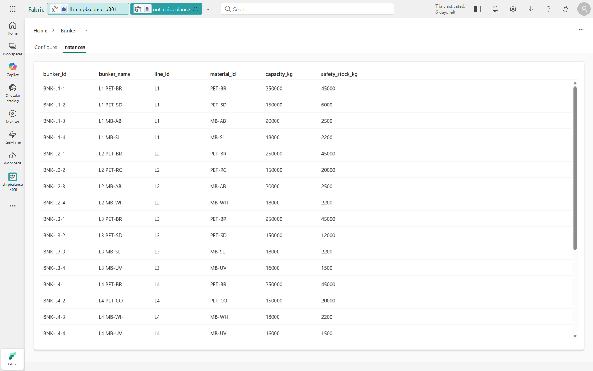

4.  **Configure** 탭으로 돌아가 오른쪽 위 **Manage relationships**를 누르고 일별 재고와 벙커를 연결한 관계(참고 이름 **BalanceOfBunker**)를 누릅니다.

    **확인할 결과:** 일별 재고 한 행이 해당 벙커와 실제 원본 열로 연결됩니다. 참고 설계는 **Origin entity type** `DailyBalance`, **Target entity type** `Bunker`, 양쪽 **Property** `bunker_id`입니다. 방향이나 이름이 달라도 두 원본의 연결이 정확한지 확인합니다.

    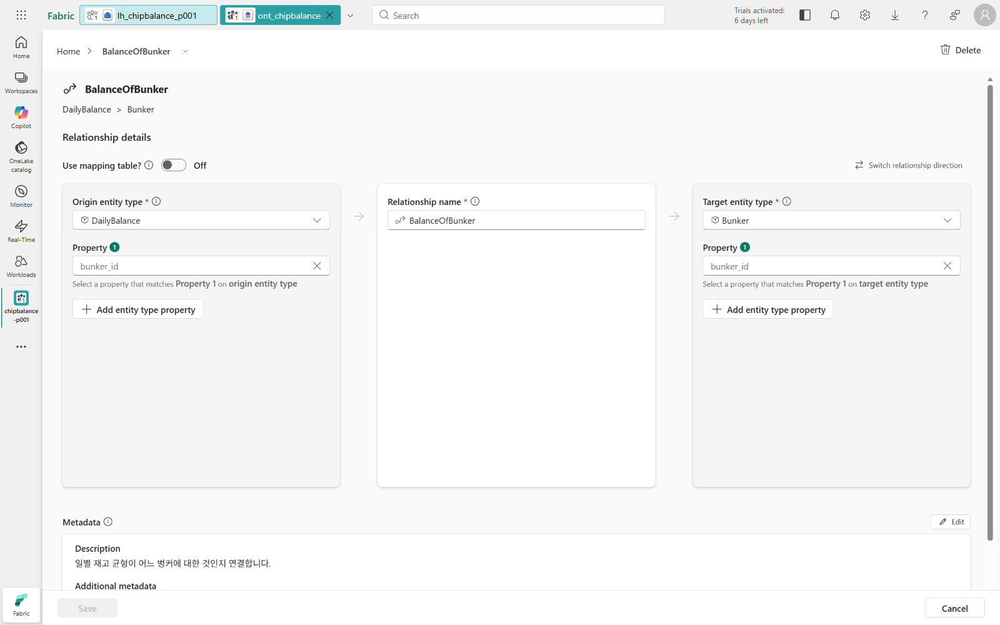

5.  아무것도 바꾸지 않고 오른쪽 아래 **Cancel**을 누른 뒤, 왼쪽 위 **Home**을 누릅니다.

6.  다른 엔터티 타입도 **Explorer → 타입 선택 → View Entity Type details → Configure**에서 검토한 초안의 원본·키와 대조합니다. 특히 시나리오별 생산계획·납기·일별 재고의 키를 확인합니다. 참고 설계는 각각 `plan_key`, `fulfillment_key`, `balance_key`를 사용합니다. 시나리오별 행을 구분해야 하므로 판매오더나 Bunker ID만으로 키를 대신하지 않습니다.

**점검을 마쳤으면:** 업무 질문에 필요한 구조와 원본 테이블·키·바인딩, Bunker 24개의 실제 데이터를 확인한 상태입니다. 대응안·대응안별 재고·위험 이벤트도 실제 행이 읽히는지 확인합니다. **바로 09장으로 넘어가도 됩니다.** Graph 관계 탐색까지 해 볼 때만 아래 5단계를 진행합니다.

## 5. Graph 만들기 (선택)

Graph는 실제 엔터티 **인스턴스**를 노드로, 연결된 인스턴스 사이의 관계를 에지로 저장합니다. 여러 단계의 관계 탐색을 해 볼 때 별도로 **Materialize**합니다. 앞 단계의 **Instances** 조회와 09장의 질문 실습을 위해 반드시 만들 필요는 없으며, 생성·조회에는 준비된 유료 용량을 사용합니다.

**엔터티 타입 수는 노드 수가 아닙니다.** 각 타입에 연결된 데이터 행들이 노드가 됩니다. 아래 캡처는 참고 설계의 17개 타입을 투영하는 화면입니다. 진행하지 않을 경우 아래 단계를 건너뛰고 09장으로 이동합니다.

1.  리본의 **Manage graph**를 누릅니다. **Choose what to project** 화면이 열립니다.

2.  **Entities** 표에서 엔터티 하나(참고 화면에서는 **Line**)의 왼쪽 **\>**를 눌러 펼칩니다.

    **확인할 결과:** **Use the entire Ontology**가 **Yes**이고, 본인의 엔터티 타입과 관계가 선택되어 있으며 **Status**가 **Eligible**입니다. 오른쪽 **Preview**에 투영할 구조가 보입니다. 아래 참고 화면의 개수·이름과 같을 필요는 없습니다. **Ineligible**이나 **Not mapped**가 있으면 Materialize하기 전에 아래 Troubleshooting으로 원본 연결을 확인합니다.

    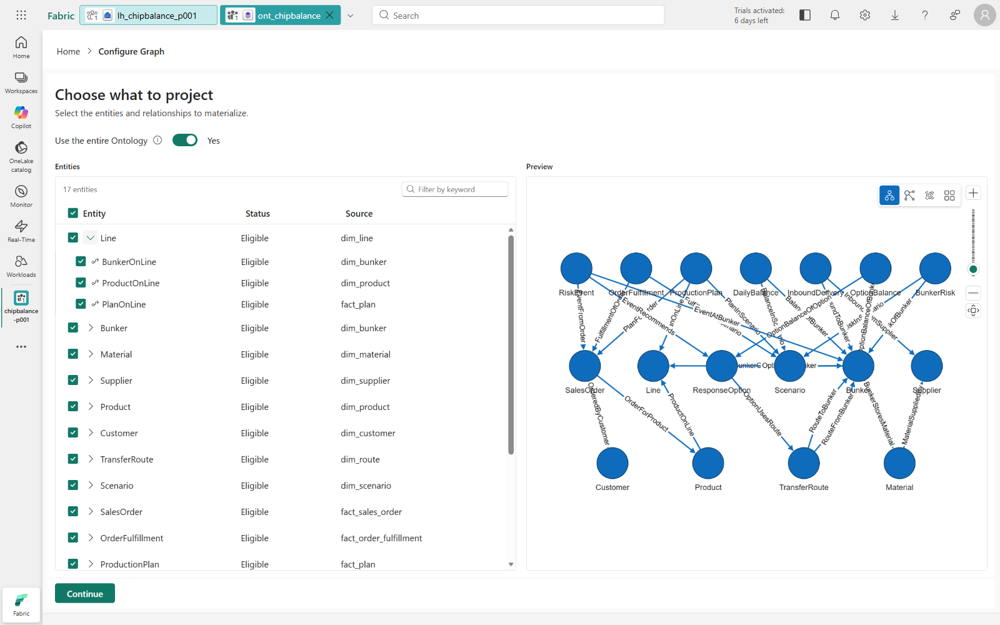

3.  왼쪽 아래 **Continue**를 누르고, **Configure projection** 화면에서 왼쪽 아래 **Materialize**를 누릅니다.

    **시작 확인:** 오른쪽 위에 **Creating graph model** 알림이 보이고, 위쪽 탭에 `ont_chipbalance_graph_`로 시작하는 Graph model이 열립니다. 참고 시간은 5–15분이며, 데이터량과 용량 상태에 따라 수분–수시간 걸릴 수 있습니다. 이 알림은 생성 시작을 뜻하므로 완료로 판단하지 않습니다.

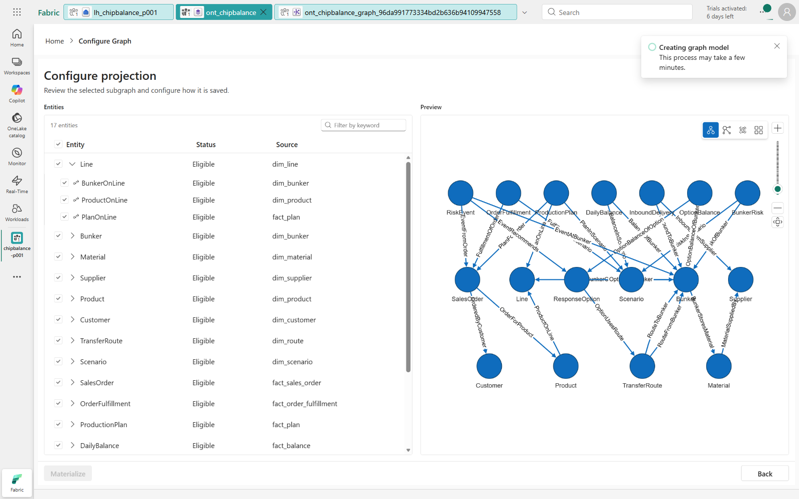

4.  생성이 끝나면 `ont_chipbalance`의 **Home**으로 돌아가 리본의 **Explore graph**를 누릅니다. 실제 인스턴스의 노드·에지가 조회되는지 확인합니다. Graph 생성·조회가 되지 않아도 **1–4단계의 Ontology 점검을 마쳤다면 09장 질문 실습은 진행할 수 있습니다.**

## 이 장의 완료 기준

- **필수:** `ont_chipbalance`에 검토한 설계가 적용되어 있고, 현재 계획·긴급 계획의 재고, 납기, 입고, 대응안 비교와 위험 이벤트의 근거 연결을 지원합니다. 특정 엔터티·관계 개수는 완료 기준이 아닙니다.
- **데이터 확인:** 키·관계 양쪽 열·바인딩이 원본과 일치하고, Bunker 24개와 대응안·대응안별 재고·위험 이벤트의 실제 데이터를 읽었습니다. `BNK-L3-2`의 용량 150,000 kg·안전재고 12,000 kg도 확인했습니다.
- **선택:** Graph를 만들었다면 생성 알림뿐 아니라 실제 노드·에지 조회까지 확인합니다. 만들지 않아도 필수 단계 완료에는 영향이 없습니다.

## Troubleshooting

- **대응안 비교나 위험 이벤트가 빠진 경우:** 개수가 아니라 필요한 업무 범위의 누락이 문제입니다. 원본을 확인하기 전에는 Act로 적용하지 않습니다. 이미 적용했다면 Ontology를 삭제하지 말고, 원본 확인 후 같은 Ontology에 보완합니다. 아래 요청의 `p001`을 본인 번호로 바꿔 Plan 모드에서 보냅니다.

  ``` text
  대응안 비교와 위험 이벤트의 근거 연결이 빠져 있으므로 최종 완료로 처리하지 마.
  lh_chipbalance_p001의 gold.fact_response_option, gold.fact_option_balance, gold.fact_risk_event를 다시 확인해줘.
  각 테이블의 존재 확인, 열·키 확인, 실제 행 읽기 결과를 구분해서 보여줘. 실패하면 조회 대상과 오류 원문을 보여주고, 읽기 실패만으로 테이블이 없다고 단정하지 마.
  세 테이블을 읽을 수 있으면 해당 업무 질문을 지원할 엔터티·키·관계를 제안하고 선택 이유와 검증 결과를 보여줘. 기존 항목은 유지하고 중복 생성하지 마. 개수나 이름을 참고 설계에 맞추려고 하지 마.
  읽을 수 없으면 축소하거나 적용하지 말고 원본 확인 단계에서 중단해. 적용은 내가 검토한 뒤 Act 모드에서 승인할 때만 해.
  ```

- 원본 테이블이 실제로 없을 때만 06장을 실행합니다. 06장 재실행은 승인된 위험 이벤트도 `open`으로 덮어쓰므로 단순한 화면 목록 문제에 사용하지 않습니다.
- **Manage graph**에서 관계의 **Source**가 **Not mapped**이면 방향부터 뒤집지 말고 관계 설정을 엽니다.
  - 양쪽 엔터티의 키와 데이터 바인딩, **Origin/Target entity type**의 **Property**를 확인합니다. `BalanceOfBunker`는 DailyBalance의 `bunker_id`와 Bunker의 `bunker_id`를 연결하며, 두 속성의 원본 열과 형식·값이 맞아야 합니다.
  - **Use mapping table?**가 **Off**이면 양쪽 속성을 직접 연결합니다. **On**이면 매핑 테이블의 각 열이 양쪽 속성에 올바르게 연결됐는지 확인하고 **Save**합니다.
  - **Status**가 **Ineligible**이면 마우스를 올려 사유를 봅니다. 키 누락, 미바인딩, 여러 원본 테이블, 지원하지 않는 원본도 원인입니다. 현재 Graph는 Lakehouse·Mirrored Database의 Delta 테이블을 지원합니다([Graph 제한 사항](https://learn.microsoft.com/en-us/fabric/iq/ontology/how-to-use-ontology-graph#limitations)).
- 적용을 요청했는데 아무 변화가 없으면 입력 칸 아래 스위치가 **Act**인지 확인합니다.
- 브라우저를 새로 고치면 에이전트 대화가 사라집니다. 이미 적용한 엔터티 타입과 관계는 Ontology에 남아 있습니다.
- 에이전트가 답하지 않거나 오류를 보이면 같은 대화에 `Try again`을 보냅니다.
- **Instances**에 데이터가 없으면 05장 **3. Fabric Lakehouse에서 Gold 확인**으로 본인 Lakehouse에 `gold` 테이블이 있는지 확인합니다. 테이블이 있으면 해당 타입의 **Configure**에서 **Data source**가 그 테이블을 가리키는지와 본인 계정의 원본 읽기 권한을 확인합니다.

## 공식 문서

- [Ontology agent 사용·권한·Plan/Act 모드](https://learn.microsoft.com/en-us/fabric/iq/ontology/how-to-use-ontology-agent)
- [관계 타입과 양쪽 속성·매핑 테이블](https://learn.microsoft.com/en-us/fabric/iq/ontology/how-to-create-relationship-types)
- [선택적 Graph 생성과 제한 사항](https://learn.microsoft.com/en-us/fabric/iq/ontology/how-to-use-ontology-graph)

## 다음 단계

[09. Data agent로 Ontology에 질문하기](09-data-agent.md)에서 업무 설명을 확인하고, 별도 Data agent에 이 Ontology를 연결해 원료 부족·납기·추천안을 정답과 비교합니다.
