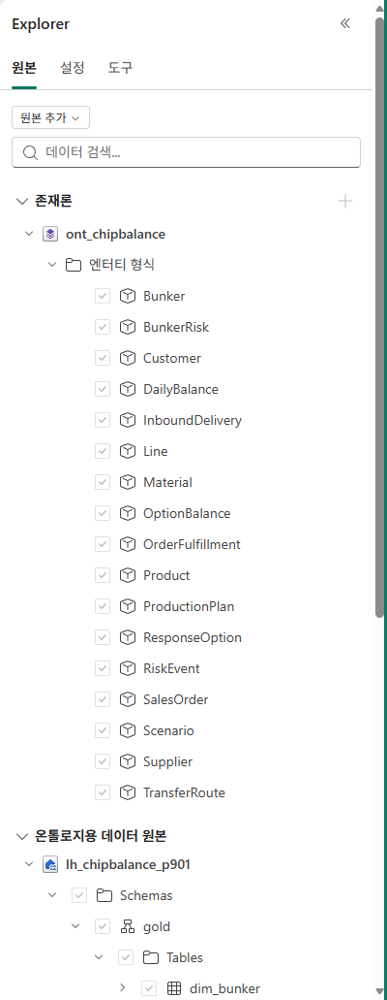
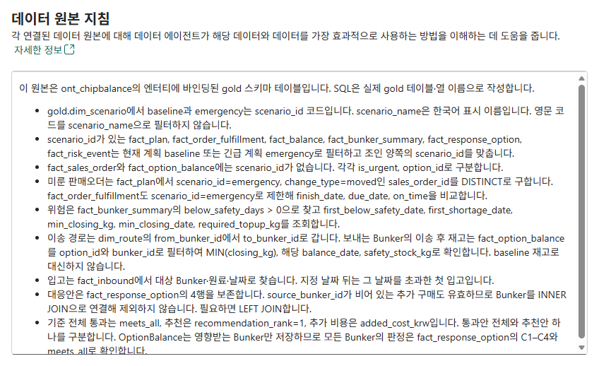
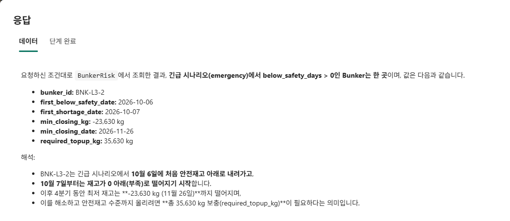
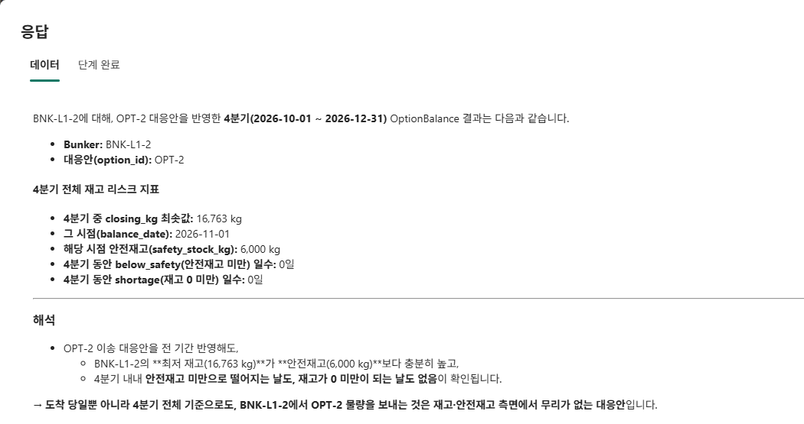
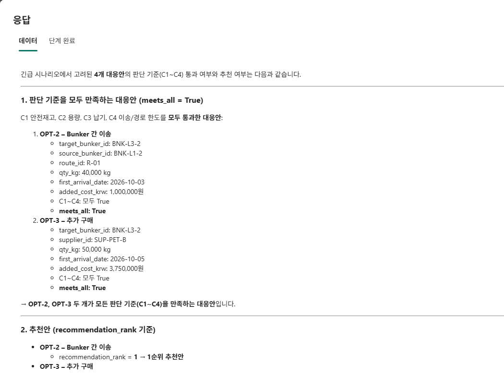

# 09. Data agent로 Ontology에 질문하기

[목차](../README.md) \| 이전: [08. Ontology](08-ontology.md) \| 다음: [10. Power BI 보고서](10-power-bi.md)

08장에서 만든 Ontology를 **Fabric Data agent의 원본으로 연결**하고, 원료 부족·납기·대응안을 한국어로 질문합니다. 목표는 그럴듯한 설명을 받는 것이 아니라 **6개 질문의 핵심 값과 조회 범위가 Notebook 정답과 맞는지 확인하는 것**입니다.

**업무 설명 준비 → Data agent 만들기 → Ontology 연결 → 지침 저장 → 질문·근거 확인** 순서로 진행합니다. 08장의 **내장 Ontology agent는 구조 작성**, 이 장의 **별도 Data agent는 업무 질의**에 사용합니다. 12장의 Foundry는 Fabric IQ로 Ontology에 직접 질문하는 별도 경로입니다.

## 시작 전 확인

- 본인 `ont_chipbalance`가 재고·납기·입고·대응안 비교·위험 이벤트의 업무 범위를 지원하고, 키·바인딩과 실제 데이터를 08장에서 확인했습니다. **Graph 생성은 필수가 아닙니다.**
- 07장의 `07_answers`에서 질문 6개의 계산 정답을 확인할 수 있습니다. Genie를 만들지 않았어도 비교할 수 있습니다.
- **활성 유료 Fabric 용량**, Data agent 생성·사용을 허용하는 AI 테넌트 설정, 본인 작업 영역의 작성 권한과 **Ontology 및 바인딩된 원본의 읽기 권한**이 필요합니다([Data agent 요구 사항](https://learn.microsoft.com/fabric/data-science/concept-data-agent), [테넌트 설정](https://learn.microsoft.com/fabric/data-science/data-agent-tenant-settings)).

작업 영역·Lakehouse의 `p001`은 본인 번호로 바꿉니다. `ont_chipbalance`, `da_chipbalance`라는 항목 이름은 본인 작업 영역 안에서 그대로 사용합니다. 캡처의 참가자 번호는 예시입니다.

이 장의 `Scenario`, `ProductionPlan`, `OptionBalance` 등은 **참고 설계의 엔터티 이름**입니다. 본인 설계의 이름이나 개수는 달라도 됩니다. 요청문·지침에서 참고 이름을 쓰는 부분은 해당 업무 개념에 연결된 본인의 이름으로 바꿉니다. 물리 `gold` 테이블·열 이름은 바꾸지 않습니다.

## 1. Ontology의 업무 설명 준비

테이블의 `moved`만 보고는 "긴급 오더 때문에 미룬 생산"인지 알기 어렵습니다. 코드의 의미를 **Ontology의 Description에 남겨**, Data agent와 12장의 Foundry가 같은 업무 맥락을 참고하게 합니다. 계산·판정·추천 순위는 이미 Notebook이 만든 Gold 값입니다.

1.  본인 `ont_chipbalance`에서 **Home → Ontology agent**를 열고 **Act**를 선택합니다.
2.  아래 요청은 현재 확인된 **Scenario, Plan, BunkerBalance, Route, OrderFulfillment**의 설명만 보강합니다. 본인 온톨로지에서 이름이 다르면 원본 바인딩으로 대응되는 타입을 확인합니다. 없는 타입을 추가하거나 이름·키·바인딩·관계를 바꾸는 단계가 아닙니다.

    ``` text
    현재 온톨로지에 존재하고 원본에 바인딩된 아래 타입의 설명에만 업무 의미를 한국어로 반영해줘.
    이름이 다르면 괄호 안의 원본 테이블로 대응 타입을 찾아줘. 실제 바인딩된 열에 해당하는 설명만 넣고, 없는 타입이나 열은 건너뛰어줘.
    이름, 키, 속성, 데이터 바인딩, 관계는 변경하지 말고, 새 타입이나 데이터를 만들지 마. 이미 같은 설명이 있으면 중복해서 덧붙이지 마.
    - Scenario (gold.dim_scenario): scenario_id의 baseline은 현재 계획, emergency는 긴급 오더를 반영한 계획입니다. scenario_name은 표시 이름이며 scenario_id 코드와 구분합니다.
    - Plan (gold.fact_plan): change_type의 urgent는 긴급 오더 생산, moved는 긴급 오더 때문에 뒤로 미룬 생산, none은 변경하지 않은 생산입니다. original_plan_date는 변경 전 생산일입니다. 생산계획은 scenario_id로 구분합니다.
    - BunkerBalance (gold.fact_balance): 시나리오·벙커·날짜별 재고입니다. closing_kg는 기말 재고, safety_stock_kg는 안전재고이며 below_safety는 기말 재고가 안전재고보다 적은 상태, shortage는 기말 재고가 0보다 적은 상태입니다.
    - Route (gold.dim_route): from_bunker_id는 보내는 벙커, to_bunker_id는 받는 벙커입니다. max_kg_per_day는 하루 이송 한도, lead_time_days는 이송 소요일입니다. 경로 정보 자체는 이송 실행 결과가 아닙니다.
    - OrderFulfillment (gold.fact_order_fulfillment): 시나리오별 판매오더의 납기 준수 결과입니다. finish_date는 생산 완료일, due_date는 납기이며 on_time이 true면 생산 완료일이 납기 이내입니다.
    수정한 타입과 건너뛴 항목을 구분해 보여줘. 이 요청은 설명 보강이며, 현재 데이터로 확인할 수 없는 업무 범위를 추가하는 요청이 아니야.
    ```

3.  변경 요약에서 **설명만 수정**했는지 확인합니다. Explorer에서 **Plan → View Entity Type details → Configure → Description**을 열어 문장이 저장됐는지 확인하고, 나머지 대상 타입도 같은 방법으로 봅니다. 이름이 다르면 `gold.fact_plan`에 연결된 타입을 선택합니다.

**확인할 결과:** 현재 존재하는 대상 타입의 설명에 업무 의미가 반영되고 구조·바인딩은 유지됩니다. 건너뛴 항목은 설명 보강 결과에서 구분합니다. 이 단계의 완료가 대응안 비교나 위험 이벤트 데이터까지 준비됐다는 뜻은 아닙니다. 이 설명은 실행 규칙이 아닙니다. **Overview → Rules**의 Business rule도 자연어 메타데이터이며, 아래 Agent instructions나 데이터 원본 지침을 대신하는 것으로 간주하지 않습니다.

## 2. Data agent 만들고 Ontology 연결

1.  작업 영역 `chipbalance-p001`으로 돌아가 **+ New item / 새 항목**에서 **Data agent / 데이터 에이전트**를 고릅니다. 이름을 **`da_chipbalance`**로 입력하고 **Create / 만들기**를 누릅니다. 둘러보기 창이 나오면 **Skip for now / 지금은 건너뛰기**를 누릅니다.
2.  시작 화면의 **Add ontology / 온톨로지 추가**를 누릅니다. OneLake 카탈로그에서 `ont_chipbalance`를 검색하고 **본인 작업 영역의 Ontology**를 선택한 뒤 **Add / 추가**를 누릅니다. 이미 에이전트 편집 화면이면 **Add source / 원본 추가**에서 Ontology 연결을 선택합니다.
3.  **Explorer → Sources / 원본**에서 연결된 `ont_chipbalance`를 펼칩니다. **Entity types / 엔터티 형식**에 08장에서 적용한 타입이 있고, **Data sources for ontology / 온톨로지용 데이터 원본**에 본인의 `lh_chipbalance_p001`이 있는지 확인합니다. 아래 캡처의 17개는 참고 설계의 개수입니다.

    

**확인할 결과:** Ontology와 **그 바인딩에서 연결된 Lakehouse**가 함께 표시됩니다. 해당 엔터티가 사용하는 테이블·열만 원본에 노출될 수 있습니다. 이것은 Gold 복사나 새 Ontology 생성이 아닙니다. 이 실습에서는 Lakehouse를 **기타 데이터 원본**으로 중복 추가하지 않습니다.

한글 UI에서 Ontology 구역이 **존재론**으로 표시될 수 있습니다. 제품·교재의 업무 개념은 **Ontology(온톨로지)**로 읽습니다.

## 3. 에이전트 지침과 데이터 원본 지침 저장

지침은 두 위치에 넣습니다. **Agent instructions**는 답변 방식·원본 선택을, **Data source instructions**는 실제 열·필터·조인 규칙을 설명합니다. Ontology 연결만으로 모든 쿼리가 정확해지는 것은 아닙니다.

### 에이전트 지침

1.  **Explorer → Setup / 설정 → Agent instructions / 에이전트 지침**을 엽니다.
2.  Markdown 영역을 눌러 편집하고 기본 안내 문장을 전체 선택해 지웁니다. 아래 내용을 붙여 넣은 뒤 **Markdown preview / 미리 보기 영역**을 눌러 저장합니다. 화면에 저장 버튼이 있으면 저장합니다.

    ``` text
    이 Data agent는 필름 공장 Chip Balance의 원료 수급과 긴급 수주 대응안을 읽기 전용으로 설명합니다.
    - ont_chipbalance의 엔터티 타입·관계·설명과 연결된 OneLake Gold를 근거로 조회합니다. 별도 원본이나 인터넷 정보로 숫자를 추측하지 않습니다.
    - baseline은 긴급 오더를 반영하지 않은 현재 계획, emergency는 긴급 오더를 반영한 계획입니다. 질문에 시나리오가 없으면 baseline으로 답합니다. baseline과 emergency는 scenario_id 코드이고 scenario_name은 한국어 표시 이름입니다.
    - moved 판매오더 수는 sales_order_id를 중복 없이 세고, ProductionPlan과 OrderFulfillment 모두 emergency로 제한합니다.
    - below_safety는 closing_kg가 safety_stock_kg보다 적은 날, shortage는 closing_kg가 0보다 적은 날입니다. 최저 재고와 안전재고까지의 필요 보충량을 구분합니다.
    - 기준을 모두 통과한 대응안 전체를 보여 주고, 그중 recommendation_rank=1을 추천안으로 구분합니다. 추가 비용은 added_cost_krw입니다.
    - 이송 후 보내는 Bunker의 재고는 해당 대응안의 OptionBalance로 확인합니다. 현재 계획 재고나 도착 당일 값만으로 전 기간 안전성을 판단하지 않습니다.
    - source_bunker_id가 비어 있는 구매 등의 대응안도 제외하지 않습니다. 필요하면 Bunker를 LEFT JOIN합니다.
    - 한국어로 짧게 답하고 근거 엔터티·시나리오·Bunker·날짜·kg·원 값을 함께 보여 줍니다. 조회가 실패하면 확인되지 않은 숫자를 제시하지 않습니다.
    - 발주·이송·승인·데이터 변경은 하지 않습니다. 결정은 담당자가 Teams에서 합니다.
    ```

### 데이터 원본 지침

1.  같은 **Setup / 설정**의 **온톨로지용 데이터 원본**에서 본인 Lakehouse 행에 마우스를 올립니다.
2.  **Add custom setup / 사용자 지정 설정 추가**를 누르고, 생긴 **Data source instructions / 데이터 원본 지침**을 엽니다. 이미 항목이 있으면 바로 엽니다.
3.  **데이터 원본 설명**과 **데이터 원본 지침** 중 **지침** 영역에 아래 내용을 넣고 저장합니다.

    ``` text
    이 원본은 ont_chipbalance의 엔터티에 바인딩된 gold 스키마 테이블입니다. SQL은 실제 gold 테이블·열 이름으로 작성합니다.
    - gold.dim_scenario에서 baseline과 emergency는 scenario_id 코드입니다. scenario_name은 한국어 표시 이름입니다. 영문 코드를 scenario_name으로 필터하지 않습니다.
    - scenario_id가 있는 fact_plan, fact_order_fulfillment, fact_balance, fact_bunker_summary, fact_response_option, fact_risk_event는 현재 계획 baseline 또는 긴급 계획 emergency로 필터하고 조인 양쪽의 scenario_id를 맞춥니다.
    - fact_sales_order와 fact_option_balance에는 scenario_id가 없습니다. 각각 is_urgent, option_id로 구분합니다.
    - 미룬 판매오더는 fact_plan에서 scenario_id=emergency, change_type=moved인 sales_order_id를 DISTINCT로 구합니다. fact_order_fulfillment도 scenario_id=emergency로 제한해 finish_date, due_date, on_time을 비교합니다.
    - 위험은 fact_bunker_summary의 below_safety_days > 0으로 찾고 first_below_safety_date, first_shortage_date, min_closing_kg, min_closing_date, required_topup_kg를 조회합니다.
    - 이송 경로는 dim_route의 from_bunker_id에서 to_bunker_id로 갑니다. 보내는 Bunker의 이송 후 재고는 fact_option_balance를 option_id와 bunker_id로 필터하여 MIN(closing_kg), 해당 balance_date, safety_stock_kg로 확인합니다. baseline 재고로 대신하지 않습니다.
    - 입고는 fact_inbound에서 bunker_id·material_id와 expected_date로 찾습니다. 지정 날짜 뒤는 그 날짜를 초과한 첫 입고입니다. 공급사는 supplier_id로 dim_supplier를 연결하고 quantity_kg를 읽습니다.
    - 대응안은 fact_response_option의 4행을 보존합니다. source_bunker_id가 비어 있는 추가 구매도 유효하므로 Bunker를 INNER JOIN으로 연결해 제외하지 않습니다. 필요하면 LEFT JOIN합니다.
    - 기준 전체 통과는 meets_all, 추천은 recommendation_rank=1, 추가 비용은 added_cost_krw입니다. 통과안 전체와 추천안 하나를 구분합니다. OptionBalance는 영향받는 Bunker만 저장하므로 모든 Bunker의 판정은 fact_response_option의 C1–C4와 meets_all로 확인합니다.
    ```

    

**확인할 결과:** 편집 영역을 다시 열어 저장된 지침을 읽을 수 있습니다. `Ctrl+A`로 기본 문장을 지운 뒤 붙여 넣어야 하며, 입력한 문장 뒤에 기본 안내가 남아 있지 않은지 확인합니다. 질문의 **정답 숫자를 지침에 넣어 답을 맞추지 않습니다.**

## 4. 한국어로 질문하고 계산 정답과 비교

1.  **Test data agent / 테스트 데이터 에이전트**를 열고 **응답 테스트** 입력란에 아래 질문을 하나씩 보냅니다.
2.  답을 받은 뒤 07장의 정답과 비교합니다. 지침을 수정했다면 **Clear chat / 채팅 지우기**로 새 대화에서 다시 평가합니다. 브라우저 새로 고침만으로 대화가 초기화된다고 가정하지 않습니다.

| 번호 | 질문 | 확인할 정답 |
|---|---|---|
| Q1 | 긴급 오더를 반영하지 않은 현재 계획에서 4분기에 안전재고 아래로 내려가는 Bunker가 있어? | 없음 (`baseline`) |
| Q2 | 긴급 오더를 반영하면 어느 Bunker가 언제부터 안전재고 아래로 내려가고, 얼마나 부족해? | BNK-L3-2. 미달 10/06, 부족 10/07. 최저 -23,630kg(11/26), 필요 보충량 35,630kg |
| Q3 | 긴급 오더 때문에 미뤄진 생산의 판매오더는 납기를 지켜? | 중복 없는 3건 모두 준수. SO-10108: 10/08 완료·10/11 납기, SO-10109: 10/10 완료·10/14 납기, SO-10110: 10/12 완료·10/15 납기 |
| Q4 | BNK-L3-2로 PET-SD를 보내 줄 수 있는 Bunker는 어디야? 이송 대응안대로 보내면 보내는 Bunker의 재고는 괜찮아? | BNK-L1-2, R-01, OPT-2. 이송 후 4분기 최저 16,763kg(11/01), 안전재고 6,000kg 이상 |
| Q5 | BNK-L3-2에 10월 6일 뒤 처음 들어오는 PET-SD 입고는 언제, 어느 공급사에서, 몇 kg이야? | 2026-10-09, SUP-PET-B(세미폴리머), 25,000kg |
| Q6 | 대응안 4개 가운데 판단 기준을 모두 만족하는 안과 추천안은? | 통과 OPT-2·OPT-3. 추천 OPT-2(1순위, 1,000,000원), OPT-3은 2순위 |

**전체 기간을 확인합니다.** Q2의 첫 미달일 부족량과 4분기 최저 재고·보충량은 다릅니다. Q4도 **도착 당일에 안전하다는 답만으로 완료하지 않습니다.** 아래처럼 조회 범위·열을 밝혀 필요한 근거를 확인합니다. 정답 숫자는 질문에 넣지 않습니다.

**Q2의 전체 위험 요약 확인**

``` text
scenario_id=emergency인 BunkerRisk에서 below_safety_days > 0인 Bunker의 bunker_id, first_below_safety_date, first_shortage_date, min_closing_kg, min_closing_date, required_topup_kg를 조회해 주세요.
```



**Q4의 보내는 Bunker 전체 기간 확인**

``` text
OPT-2를 반영한 OptionBalance에서 bunker_id=BNK-L1-2인 전체 4분기 행을 대상으로 closing_kg 최솟값, 그 balance_date, safety_stock_kg와 below_safety·shortage 일수를 조회해 주세요. 도착 당일 값만으로 판단하지 말아 주세요.
```



**Q6의 통과안과 추천안 확인**



위 화면은 원본별 지침을 보완하고 필요한 경우 조회 조건을 명시해 확인한 **실제 응답 예시**입니다. 모든 첫 답이 이 결과로 나온다는 뜻이 아닙니다. 답의 표현·시간·화면은 달라도 대상·기간·숫자는 계산 정답과 맞아야 합니다.

## 5. 조회 근거 확인

1.  답의 **원본 표시 `ont_chipbalance`**와 **단계 완료 / completed steps**를 확인합니다. **응답 확장 → 데이터 / 단계 완료**에서도 답과 수행 단계를 볼 수 있습니다.
2.  조회 대상이 본인 Ontology의 연결 원본인지 확인합니다. Lakehouse 분석 단계가 보일 수 있습니다. 이는 Ontology의 맥락을 참고해 **바인딩된 물리 테이블을 조회**하는 경로이며, 내장 Ontology agent의 `ask_ontology` 호출과 같다고 설명하지 않습니다.
3.  표시되는 실행 단계·쿼리에서 아래 조건을 대조합니다. UI가 SQL 전체를 보여 주지 않으면 쿼리를 본 것으로 간주하지 말고, 확인용 질문과 정답 Notebook으로 근거 값을 대조합니다.

| 질문 | 확인할 조회 범위 |
|---|---|
| Q1·Q2 | `scenario_id`에 각각 `baseline`·`emergency`. `scenario_name`에 영문 코드를 넣지 않음 |
| Q3 | `change_type=moved`, DISTINCT 판매오더. 계획·납기 이행 양쪽 모두 `emergency` |
| Q4 | `OptionBalance`, `option_id=OPT-2`, 출발지 `BNK-L1-2`, 전체 4분기 최저 재고 |
| Q5 | `bunker_id=BNK-L3-2`, `material_id=PET-SD`, `expected_date > 2026-10-06`의 첫 행 |
| Q6 | ResponseOption 4개를 유지하고 `meets_all`·C1–C4·순위를 확인. NULL 출발지로 구매안을 제외하지 않음 |

이 장은 **초안 편집·테스트**까지 진행합니다. 다른 사용자나 외부 서비스에서 쓸 때의 **Publish / 게시·공유·MCP 인증**은 별도 준비입니다. 12장의 Ontology 직접 연결을 위해 Data agent를 게시할 필요는 없습니다.

## 이 장의 완료 기준

`da_chipbalance`에 **본인 `ont_chipbalance`와 연결 원본**이 표시되고 두 위치의 지침이 저장되어 있습니다. Q1–Q6을 비교해 **Q3은 판매오더 3건, Q4는 전 기간 재고, Q6은 통과안 2개와 추천안 1개**를 확인합니다. 해결되지 않은 답은 완료로 처리하지 않습니다.

Data agent는 데이터를 읽는 역할입니다. Gold·Ontology를 바꾸거나 승인하지 않습니다. 다음 장에서는 같은 결과를 보고서로 봅니다.

## Troubleshooting

- **온톨로지 추가**가 없거나 추가가 실패하면 올바른 테넌트·계정, 본인 Ontology, AI 설정과 용량·원본 권한을 확인합니다. UI에 원본이 보이는 것과 실제 조회 성공은 별개입니다.
- 연결 원본이나 엔터티가 빠졌으면 08장의 바인딩과 원본 읽기 권한을 확인합니다. 화면에 표시되는 **Refresh / 새로 고침**을 사용하고 원본 목록을 다시 봅니다. 캐시 문제 때문에 06장을 재실행하지 않습니다.
- `데이터 없음`이라는 답이면 실제 조회 조건을 먼저 확인합니다. 검증 중 `scenario_name='emergency'`를 써서 데이터가 있는데도 없다고 답한 사례가 있었습니다. **scenario_id**로 제한하고, 지침을 저장한 뒤 새 대화에서 다시 확인합니다.
- Q3가 0건이거나 3건보다 많으면 다음처럼 범위를 명시합니다.

  ``` text
  ProductionPlan의 scenario_id=emergency, change_type=moved인 sales_order_id를 중복 없이 구하고, OrderFulfillment도 scenario_id=emergency로 제한해 판매오더별 finish_date, due_date, on_time을 보여 주세요.
  ```

- Q4가 도착일 재고만 답하면 위 **4분기 전체 확인 질문**을 사용합니다. 첫날 값으로 전 기간의 안전성을 판단하지 않습니다.
- Q5가 입고를 찾지 못하면 ID와 날짜를 명시합니다.

  ``` text
  InboundDelivery에서 bunker_id=BNK-L3-2이고 material_id=PET-SD인 입고 중 expected_date가 2026-10-06보다 큰 첫 행을 expected_date 오름차순으로 조회해 주세요. supplier_id로 Supplier를 연결해 공급사 ID·이름과 quantity_kg를 보여 주세요. Bunker 이름이나 원료 이름이 아니라 ID로 필터해 주세요.
  ```

- Q6에서 OPT-3가 빠지면 `ResponseOption 4행을 모두 유지하고 Bunker는 LEFT JOIN으로 연결해 C1–C4, meets_all, 추천 순위와 비용을 다시 보여 주세요.`로 확인합니다.
- Markdown에 기본 안내가 남아 있거나 변경이 사라지면 전체 선택 후 입력·저장을 확인합니다. 새로 열어 실제 저장된 문장을 확인합니다.
- AI 모델·런타임 변경 알림은 결과가 같다는 보장이 아닙니다. 검증한 런타임에서 정답을 다시 비교합니다. 이 실습의 확인 화면은 **표준 / Standard 런타임**입니다.

## 공식 문서

- [Data agent의 지원 원본·권한·지침](https://learn.microsoft.com/fabric/data-science/concept-data-agent)
- [원본 추가·테스트·게시 절차](https://learn.microsoft.com/fabric/data-science/data-agent-end-to-end-tutorial)
- [Data agent 테넌트 설정](https://learn.microsoft.com/fabric/data-science/data-agent-tenant-settings)

## 다음 단계

[10. Power BI 보고서](10-power-bi.md)에서 같은 Gold 계산 결과를 수급 현황과 대응안 비교 화면으로 만듭니다.
